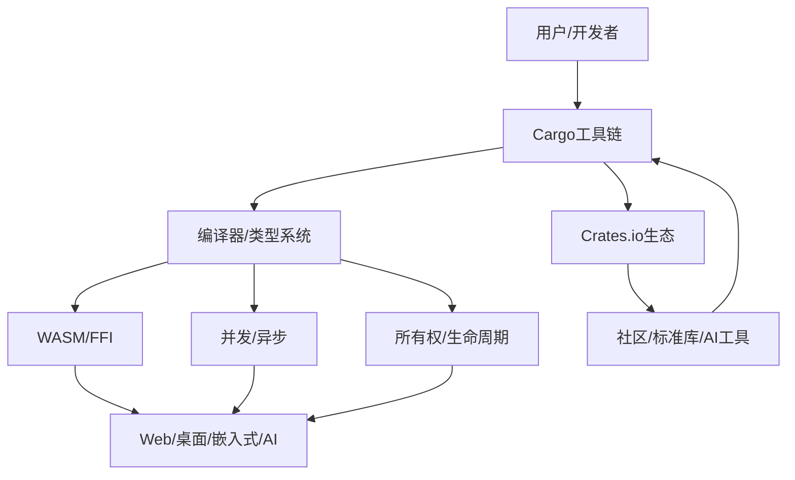

# 3.1 Rust

[返回本目录](./README.md) | [返回Refactor总览](../README.md)

---

## 目录

- [UI通用架构模型在Rust中的应用](#ui通用架构模型在rust中的应用)
- [1.1 理论定位与学科交叉](#11-理论定位与学科交叉)
- [1.2 发展脉络与范式演化](#12-发展脉络与范式演化)
- [4.1 形式化建模与证明](#41-形式化建模与证明)
- [4.2 多表征与跨学科映射](#42-多表征与跨学科映射)
- [5.1 与其他主题的交叉引用](#51-与其他主题的交叉引用)
- [5.2 相关性分析](#52-相关性分析)

---

# 2024前沿趋势

- WebAssembly 2.0与Rust：Rust主导WASM生态，支持多线程、SIMD、模块化、WASI 2.0。
- 全栈开发：Leptos、Yew、Axum、Tauri等推动Rust前后端一体化。
- AI与高性能计算：Rust在AI推理、深度学习、数据处理中的应用增长，Rust+Python互操作。
- 安全与并发：所有权、借用、无GC并发安全，应用于区块链、嵌入式、云原生。
- 跨语言与FFI：Rust与JS、Python、C/C++、Go等高效互操作。
- 工程化与工具链：Cargo、Crates.io、Clippy、Miri。

---

# 3.1.1 Rust生态与架构Mermaid图



---

# 3.1.2 类型系统与并发安全LaTeX公式

- 所有权与借用规则、生命周期约束、Send/Sync 并发安全、WASM内存模型

---

# 3.1.3 跨语言与WASM代码示例

```rust
use wasm_bindgen::prelude::*;
#[wasm_bindgen]
pub fn add(a: i32, b: i32) -> i32 { a + b }
```

```js
import init, { add } from './pkg/my_wasm.js';
await init();
console.log(add(2, 3));
```

---

# 3.1.4 批判性分析与最佳实践

- 所有权与类型系统：安全与性能并重，学习曲线陡。
- WASM与跨端：高性能统一运行时，注意调试与生态兼容。

---

# 3.1.5 相关主题推荐阅读

- [2.6 Web核心技术](../2.技术栈与框架/2.6 Web核心技术.md)
- [2.2 跨端框架](../2.技术栈与框架/2.2 跨端框架.md)
- [3.4 TypeScript-JavaScript](./3.4 TypeScript-JavaScript.md)
- [4.3 组件化与架构模式](../4.设计模式与架构/4.3 组件化与架构模式.md)
- [5.3 性能优化与工程实践](../5.技术规范与标准/5.3 性能优化与工程实践.md)
- [6.1 AI基础原理](../6.人工智能原理与算法/6.1 AI基础原理.md)

---

# 1. 概述

Rust以安全性、并发性和性能为核心目标：零成本抽象、所有权与借用、类型与内存安全、并发无数据竞争。

# 1.1 理论定位与学科交叉

类型理论、所有权模型、并发计算、编译原理、操作系统、形式化方法、认知科学。

# 1.2 发展脉络与范式演化

从系统开发到WASM、全栈、嵌入式、云原生，多方向演化。

# 2. 理论基础

- 所有权与借用检查
- 并发模型
- Cargo生态
- WebAssembly支持

# 3. 主要议题

- 形式化论证与多表征
- 相关性引用

# 4. 形式化论证与多表征

## 4.1 形式化建模与证明（节选）

- 所有权唯一性、借用安全性、生命周期安全等命题与证明要点。

## 4.2 多表征与跨学科映射（节选）

- 类型理论、编译原理、OS、认知科学映射。

# 5. 相关性引用

## 5.1 与其他主题的交叉引用

- [2.3 Rust前端全栈](../2.技术栈与框架/2.3 Rust前端全栈.md)
- [2.5 WebAssembly](../2.技术栈与框架/2.5 WebAssembly.md)
- [3.2 Haskell](./3.2 Haskell.md)
- [4.1 GoF设计模式](../4.设计模式与架构/4.1 GoF设计模式.md)
- [5.1 UI-UE-UX设计规范](../5.技术规范与标准/5.1 UI-UE-UX设计规范.md)

## 5.2 相关性分析

- Rust推动工程化、自动化、可访问性与国际化等跨学科进步。

# 6. 参考文献（节选）

- Steve Klabnik, Carol Nichols. The Rust Programming Language.
- Benjamin Pierce. Types and Programming Languages.
- W3C. WebAssembly Core Specification.

