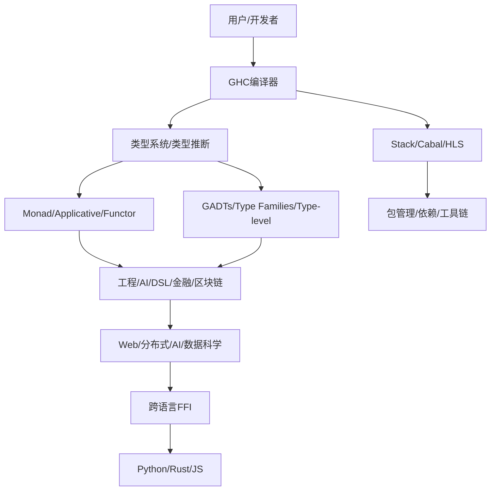

# 3.2 Haskell

[返回本目录](./README.md) |  [返回Refactor总览](../README.md)

---

# 2024前沿趋势（节选）

- GHC 9.8+、Dependent Haskell、Type Families、GADTs、Type-level Programming
- STM、Async、Cloud Haskell；Reflex、Miso、IHP
- Hasktorch、类型安全AI建模；FFI与多语言互操作

---

## 目录

- [3.2 Haskell](#32-haskell)
- [2024前沿趋势（节选）](#2024前沿趋势节选)
  - [目录](#目录)
  - [3.2.1 Haskell类型系统与生态Mermaid图](#321-haskell类型系统与生态mermaid图)
  - [3.2.4 批判性分析与最佳实践](#324-批判性分析与最佳实践)
  - [3.2.5 相关主题推荐阅读](#325-相关主题推荐阅读)
  - [1 概述与理论定位（节选）](#1-概述与理论定位节选)
  - [2 理论基础与范式（节选）](#2-理论基础与范式节选)
  - [3 形式化与多表征（节选）](#3-形式化与多表征节选)

---

## 3.2.1 Haskell类型系统与生态Mermaid图

---

## 3.2.4 批判性分析与最佳实践

- 类型系统极致表达与验证力；学习曲线与生态集成权衡。
- STM等并发模型安全但需场景化调优。

---

## 3.2.5 相关主题推荐阅读

- [2.6 Web核心技术](../2.技术栈与框架/2.6 Web核心技术.md)
- [3.1 Rust](./3.1 Rust.md)
- [3.4 TypeScript-JavaScript](./3.4 TypeScript-JavaScript.md)
- [4.3 组件化与架构模式](../4.设计模式与架构/4.3 组件化与架构模式.md)
- [5.4 代码示例与形式化证明](../5.技术规范与标准/5.4 代码示例与形式化证明.md)

---

## 1 概述与理论定位（节选）

Haskell以纯函数、类型安全、不可变性和高抽象能力为核心；融合类型理论、λ演算、范畴论、形式化方法。

## 2 理论基础与范式（节选）

- 纯函数与不可变性、惰性求值
- 类型推断、类型类、单子、副作用管理

## 3 形式化与多表征（节选）

- λ演算与类型系统的形式化表达
- 单子定律、惰性求值的性能模型

---

[交叉引用]

- [2.4 Haskell-Scala前端](../2.技术栈与框架/2.4 Haskell-Scala前端.md)
- [4.1 GoF设计模式](../4.设计模式与架构/4.1 GoF设计模式.md)
- [5.1 UI-UE-UX设计规范](../5.技术规范与标准/5.1 UI-UE-UX设计规范.md)
