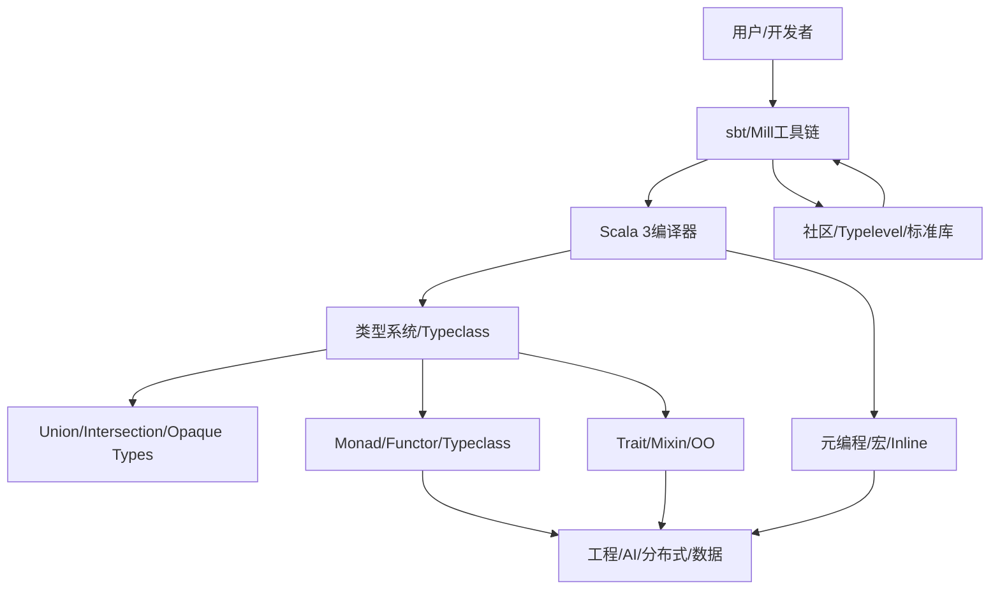

# 3.3 Scala

[返回本目录](./README.md) | [返回Refactor总览](../README.md)

---

# 2024前沿趋势（节选）

- Scala 3 类型系统（Union/Intersection、Opaque、Typeclass Derivation、Inline）
- 函数式与面向对象融合；Akka Typed、ZIO、Cats Effect
- Play、http4s、Scala.js；Spark/AI/数据工程

---

## 目录

- [3.3 Scala](#33-scala)
- [2024前沿趋势（节选）](#2024前沿趋势节选)
  - [目录](#目录)
  - [3.3.1 Scala类型系统与生态Mermaid图](#331-scala类型系统与生态mermaid图)
  - [3.3.4 批判性分析与最佳实践](#334-批判性分析与最佳实践)
  - [3.3.5 相关主题推荐阅读](#335-相关主题推荐阅读)
  - [1 概述（节选）](#1-概述节选)
  - [2 理论基础（节选）](#2-理论基础节选)

---

## 3.3.1 Scala类型系统与生态Mermaid图

---

## 3.3.4 批判性分析与最佳实践

- 多范式融合提升表达力，但需控制范式切换的认知负担。
- 分布式Actor模型的可扩展性与一致性权衡。

---

## 3.3.5 相关主题推荐阅读

- [2.6 Web核心技术](../2.技术栈与框架/2.6 Web核心技术.md)
- [3.1 Rust](./3.1 Rust.md)
- [3.2 Haskell](./3.2 Haskell.md)
- [3.4 TypeScript-JavaScript](./3.4 TypeScript-JavaScript.md)
- [4.3 组件化与架构模式](../4.设计模式与架构/4.3 组件化与架构模式.md)
- [5.4 代码示例与形式化证明](../5.技术规范与标准/5.4 代码示例与形式化证明.md)

---

## 1 概述（节选）

Scala融合OO与FP：类型安全、抽象表达、组合性、并发友好。

## 2 理论基础（节选）

- 类型系统、并发模型、函数式编程、工具链
